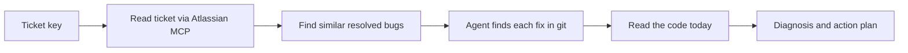

<div align="center">
  
  <h1>claude-bug-diagnose</h1>
  <p>A Claude Code plugin that diagnoses Jira bugs from evidence</p>

  
  
  
  
</div>

---

### From a Jira key to a probable root cause

Point Claude Code at a bug ticket and get a diagnosis built from evidence: the ticket, similar bugs that were already fixed, the commits that fixed them, and the code as it is today.

```text
/bug-diagnose:bug-diagnose PROJ-123
```

---

## Table of Contents

| Section | Description |
| --- | --- |
| [What it does](#what-it-does) | The problem this plugin solves |
| [How it works](#how-it-works) | The diagnosis pipeline |
| [Example output](#example-output) | What a report looks like |
| [Install](#install) | Add the marketplace and the plugin |
| [Requirements](#requirements) | What you need before the first run |
| [Repository layout](#repository-layout) | Where things live |
| [Testing the plugin](#testing-the-plugin) | Backtesting without leaking the answer |
| [Limits](#limits) | What it cannot do yet |
| [Contributing](#contributing) | Contribution guidelines |
| [License](#license) | Apache-2.0 |

---

## What it does

Triaging a bug usually starts the same way. Read the ticket, remember (or hunt for) a similar bug somebody fixed last year, find the commit, see what changed, then look at the code and decide whether this is the same problem coming back.

`bug-diagnose` does that legwork. It reads the ticket through your Atlassian MCP, finds up to three similar resolved bugs, locates the fix for each one in git, reads the suspect code now, and writes a short report. Every claim in the diagnosis is marked as a **Fact** (with a ticket, commit or `file:line` behind it) or a **Hypothesis**, and the report carries a confidence level. When the evidence is thin, it says what is missing instead of filling the gap.

---

## How it works



| Step | What happens |
| --- | --- |
| **Ticket** | Fetches fields, comments and links, then extracts two or three distinctive error tokens. A whole stack trace is never used as a search term. |
| **Similar bugs** | Checks the ticket's own links first, then runs progressively broader JQL queries for resolved bugs, keeping at most three. |
| **Fixes** | The `bug-history-investigator` agent matches ticket keys in commit messages, falls back to merged PRs, and returns a short summary per fix. Large diffs stay inside the agent. |
| **Code today** | Reads the suspect area and uses `git log -S` and `git blame` to check whether a past fix was reverted or overwritten. |
| **Validation** | Reads your repository docs to learn how it is tested. If there are no tests, it says so and proposes manual steps. |

> [!NOTE]
> Content from tickets, comments, commit messages and PRs is treated as data. The skill never follows instructions found in it.

---

## Example output

> [!IMPORTANT]
> Illustrative only. The ticket, commit and path below are made up.

```text
Problem
  Tooltip stays open after its host element is removed. Component: overlay.

Similar bugs
  PROJ-101  Overlay not closed on route change.
            Fixed in a1b2c3d by hiding the overlay in ngOnDestroy.

Diagnosis
  Probable root cause: the directive never hides the tooltip on destroy.
  Same pattern as PROJ-101 (Fact: a1b2c3d). Not a regression: the
  handler was never there (Fact: git log -S shows no earlier version).
  Confidence: medium. The destroy path is read, but not run.

Action plan
  Where to look   src/lib/tooltip/tooltip.directive.ts:84
  Suggested fix   hide the overlay in ngOnDestroy (snippet in report)
  How to validate remove the host element while open, check the tooltip closes
```

---

## Install

**1. Add the marketplace**

```text
/plugin marketplace add jhonatan-saints/claude-bug-diagnose
```

**2. Install the plugin**

```text
/plugin install bug-diagnose@bug-diagnose
```

> [!NOTE]
> Run the commands one at a time. If you use the `/plugin` menu instead, the "Add Marketplace" field takes only `jhonatan-saints/claude-bug-diagnose`.

For a local checkout, pass the folder path instead of the GitHub name.

---

## Requirements

- An Atlassian MCP with Jira access: the `atlassian` plugin from `claude-plugins-official`, or an Atlassian connector. Authentication is per developer, so nothing secret is stored in this repository.
- `git` in the repository you run it from. `gh` is optional and used as a fallback to find merged PRs.
- Ticket keys in your commit messages or PR titles (for example `PROJ-123: fix tooltip`). Without them, fix lookup gets weaker.

---

## Repository layout

```text
claude-bug-diagnose/
├── .claude-plugin/
│   └── marketplace.json       # Marketplace manifest
├── assets/                    # Logo and README artwork
└── plugins/
    └── bug-diagnose/
        ├── .claude-plugin/    # plugin.json manifest
        ├── skills/            # bug-diagnose: the diagnosis flow
        ├── agents/            # bug-history-investigator: finds and summarizes past fixes
        └── evals/             # Backtest instructions and case template
```

The plugin ships a skill and an agent only. There are no hooks and no scripts, so nothing runs on your machine outside Claude's own tool permissions.

---

## Testing the plugin

A diagnosis is only worth trusting if it was produced without the answer in sight. The skill has a backtest mode for bugs that are already fixed:

```text
/bug-diagnose:bug-diagnose PROJ-123 --before 2026-03-01
```

With `--before`, similar-bug search and git history stop at that date, the ticket's own fix is ignored, and code is read at the cutoff commit instead of the working tree. Pick the ticket's creation date as the cutoff, then compare the result with the real fix. Scoring rules and the case template are in [evals](plugins/bug-diagnose/evals/README.md).

---

## Limits

> [!WARNING]
> `bug-diagnose` is a prototype. It has not been backtested on real tickets yet, so treat its diagnoses as leads to check, not conclusions.

- Read-only behavior on Jira is an instruction to the model, not a permission boundary. If you need a hard guarantee, deny the Atlassian write tools in your own Claude Code permissions.
- Similar-bug search relies on JQL text matching, which is weak for code terms.
- It does not run tests.

---

## Contributing

- Open focused, small PRs.
- Keep the plugin free of hooks and scripts.
- Bump `version` in `plugin.json` on every behavior change, since installed copies update from it.
- Run a backtest before changing the flow of the skill, and note the result in the PR.

---

## License

Licensed under the [Apache License, Version 2.0](LICENSE). See [NOTICE](NOTICE).

---

<br/>
<div id="contact" align="center">

[](https://www.linkedin.com/in/jhonatan-saints/)

</div>

<p align="center">
  
</p>
