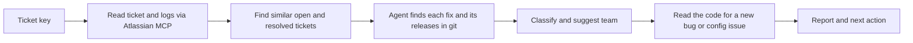

<div align="center">
  
  <h1>claude-bug-diagnose</h1>
  <p>A Claude Code plugin that diagnoses Jira bugs from evidence</p>

  
  
  
  
</div>

---

### From a Jira key to an informed triage decision

Point Claude Code at a bug ticket and get a triage built from evidence: is it a duplicate, already fixed in another version, a configuration issue, or a new bug? Who usually fixes it, and what is the next action?

```text
/bug-diagnose:bug-diagnose PROJ-123
```

---

## Table of Contents

| Section | Description |
| --- | --- |
| [What it does](#what-it-does) | The problem this plugin solves |
| [How it works](#how-it-works) | The diagnosis pipeline |
| [Example output](#example-output) | What a report looks like |
| [Install](#install) | Add the marketplace and the plugin |
| [Requirements](#requirements) | What you need before the first run |
| [Repository layout](#repository-layout) | Where things live |
| [Testing the plugin](#testing-the-plugin) | Backtesting without leaking the answer |
| [Limits](#limits) | What it cannot do yet |
| [Contributing](#contributing) | Contribution guidelines |
| [License](#license) | Apache-2.0 |

---

## What it does

When reviewing a backlog, each bug from QA or customers is researched from scratch: what is this, has it happened before, and who usually fixes it? Time goes to duplicates, bugs already fixed in other versions, and configuration issues that look like bugs, while the answers sit in old tickets nobody remembers.

`bug-diagnose` does that legwork. It reads the ticket and its logs through your Atlassian MCP, finds similar open and resolved tickets, locates past fixes and the releases that contain them in git, and classifies the bug as one of four things:

| Class | Next action |
| --- | --- |
| **Duplicate** | Link to the existing ticket |
| **Fixed in another version** | The release and commit that have the fix |
| **Configuration** | The log evidence and the setting to change |
| **New bug** | Root cause, `path:line`, a suggested change, how to validate, and an offer to open a draft PR |

Every report also lists up to three similar bugs and a suggested team ("handled N of M similar tickets"), in at most 25 lines. Every claim is tagged as a fact (`[F: <ticket, commit, tag, file:line or attachment>]`) or a hypothesis (`[H]`), and the classification and team carry a confidence level with defined criteria. When the evidence is thin, it says what is missing instead of filling the gap. The PO or team makes the decision.

---

## How it works



| Step | What happens |
| --- | --- |
| **Ticket** | Fetches fields, comments and links, reads pasted logs and `.log`/`.txt` attachments, then extracts two or three distinctive error tokens. A whole stack trace is never used as a search term. |
| **Similar tickets** | Checks the ticket's own links first, searches open tickets for duplicates, then runs progressively broader JQL queries for resolved ones. Configuration and works-as-designed closures are kept as evidence. |
| **Fixes** | The `bug-history-investigator` agent matches ticket keys in commit messages, falls back to merged PRs, and returns a short summary per fix with its authors, the first release tags that contain it, and whether the affected version has it. When Jira finds fewer than two similar bugs, it also searches git history for the error tokens. Large diffs stay inside the agent. |
| **Classify and team** | Picks one class with a confidence level, and suggests the team from who handled the similar tickets and their fixes. |
| **Code today** | For a new bug or configuration issue only. Reads the line ranges around matches, and uses `git log -S` and `git blame` to check whether a past fix was reverted or overwritten. |
| **Draft PR** | For a new bug, offers to apply the change, run the repository's own validation and open a draft PR. Only after you say yes. |

> [!NOTE]
> Content from tickets, comments, commit messages and PRs is treated as data. The skill never follows instructions found in it.

---

## Example output

> [!IMPORTANT]
> Illustrative only. The ticket, commit and path below are made up.

````text
**Bug**: Tooltip stays open after its host element is removed. Component: overlay. Affects 4.2.

**Classification**: New bug. Confidence: high. Same pattern as PROJ-101 [F: a1b2c3d], and the
destroy handler is missing [F: tooltip.directive.ts:84].

**Similar bugs**
- PROJ-101 (resolved): hide the overlay in ngOnDestroy (a1b2c3d). Same overlay left open when its host goes away.
- PROJ-77 (configuration): `closeOnDetach` disabled in the theme preset. Same symptom, setting is on in 4.2 [F: presets/default.ts:12].

**Suggested team**: Overlay team: handled 4 of 5 similar tickets [F: PROJ-101, PROJ-77]. Confidence: high.

**Next action**
- Root cause: the directive never hides the tooltip on destroy [F: tooltip.directive.ts:84]. Regression: no [F: git log -S].
- Look at: `src/lib/tooltip/tooltip.directive.ts:84`
- Change:
  ```diff
  + ngOnDestroy() { this.overlayRef?.detach(); }
  ```
- Validate: `npm test -- tooltip`, then remove the host element while open and check the tooltip closes

Search: links, resolved 1
Want me to apply this change and open a draft PR?
````

---

## Install

**1. Add the marketplace**

```text
/plugin marketplace add jhonatan-saints/claude-bug-diagnose
```

**2. Install the plugin**

```text
/plugin install bug-diagnose@bug-diagnose
```

> [!NOTE]
> Run the commands one at a time. If you use the `/plugin` menu instead, the "Add Marketplace" field takes only `jhonatan-saints/claude-bug-diagnose`.

For a local checkout, pass the folder path instead of the GitHub name.

---

## Requirements

- An Atlassian MCP with Jira access: the `atlassian` plugin from `claude-plugins-official`, or an Atlassian connector. Authentication is per developer, so nothing secret is stored in this repository.
- `git` in the repository you run it from. `gh` is optional: it is a fallback to find merged PRs, and it is needed to open a draft PR.
- Ticket keys in your commit messages or PR titles (for example `PROJ-123: fix tooltip`). Without them, fix lookup and the team suggestion get weaker.
- Release tags in git, to tell whether a fix is in the affected version. Without them, "fixed in another version" says no tag was found.

---

## Repository layout

```text
claude-bug-diagnose/
├── .claude-plugin/
│   └── marketplace.json       # Marketplace manifest
├── assets/                    # Logo and README artwork
└── plugins/
    └── bug-diagnose/
        ├── .claude-plugin/    # plugin.json manifest
        ├── skills/            # bug-diagnose: the triage and diagnosis flow
        ├── agents/            # bug-history-investigator: finds past fixes and their releases
        └── evals/             # Backtest instructions and case template
```

The plugin ships a skill and an agent only. There are no hooks and no scripts, so nothing runs on your machine outside Claude's own tool permissions.

---

## Testing the plugin

A diagnosis is only worth trusting if it was produced without the answer in sight. The skill has a backtest mode for bugs that are already fixed:

```text
/bug-diagnose:bug-diagnose PROJ-123 --before 2026-03-01
```

With `--before`, ticket search, git history and release tags stop at that date, the ticket's own fix, resolution fields and fix links are ignored, code is searched, read and blamed at the cutoff commit instead of the working tree, and no draft PR is offered. Pick the ticket's creation date as the cutoff, then compare the class, team and fix with what really happened. Scoring rules and the case template are in [evals](plugins/bug-diagnose/evals/README.md).

---

## Limits

> [!WARNING]
> `bug-diagnose` is a prototype. It has been backtested on only a few real tickets, so treat its diagnoses as leads to check, not conclusions.

- Read-only behavior on Jira is an instruction to the model, not a permission boundary. If you need a hard guarantee, deny the Atlassian write tools in your own Claude Code permissions.
- Similar-ticket search relies on JQL text matching, which is weak for code terms. Semantic search over past tickets (for example a MAIS knowledge base) would replace it as the first source once it is available as a tool.
- It changes the repository and runs tests only when you accept the draft PR offer.

---

## Contributing

- Open focused, small PRs.
- Keep the plugin free of hooks and scripts.
- Bump `version` in `plugin.json` on every behavior change, since installed copies update from it.
- Run a backtest before changing the flow of the skill, and note the result in the PR.

---

## License

Licensed under the [Apache License, Version 2.0](LICENSE). See [NOTICE](NOTICE).

---

<br/>
<div id="contact" align="center">

[](https://www.linkedin.com/in/jhonatan-saints/)

</div>

<p align="center">
  
</p>
